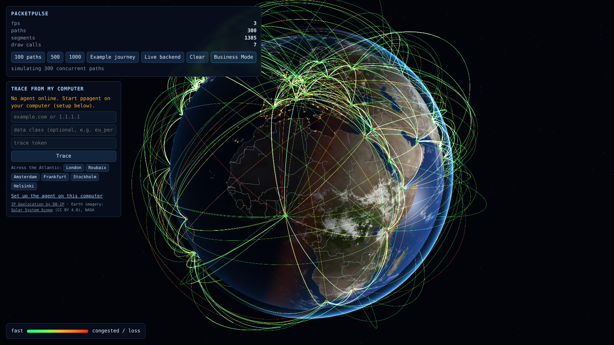
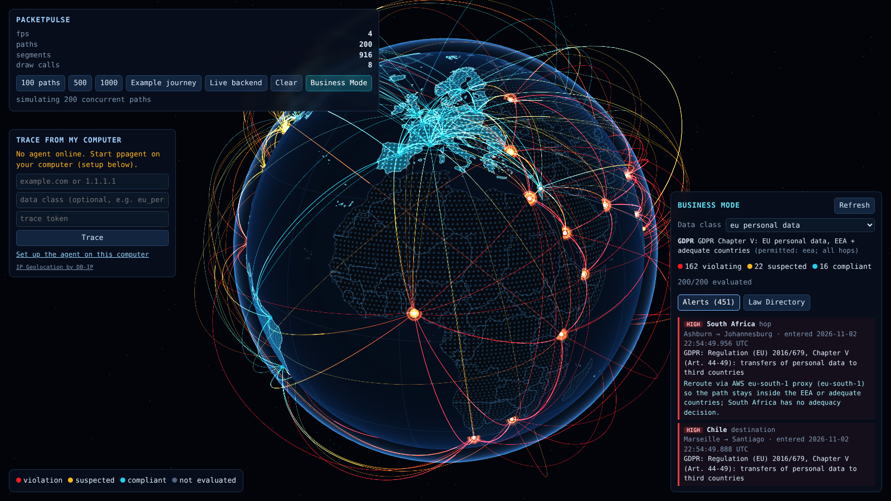
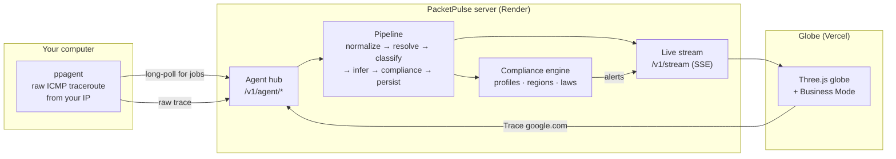

<a id="readme-top"></a>

<div align="center">



<h1>PacketPulse</h1>

<p><b>See where your packets really go, and whose laws they cross on the way.</b></p>

<p>
Traceroutes from your own computer, enriched with cables, carriers and cloud regions,<br>
drawn on a 3D globe and checked against data-sovereignty laws (GDPR, RBI, CCPA…) in real time.
</p>

<p>
<a href="https://packetpulse-eta.vercel.app"><b>Live demo</b></a>
·
<a href="#-trace-from-your-own-computer">Trace from your computer</a>
·
<a href="https://github.com/Flotrpy/PacketPulse/issues">Report a bug</a>
·
<a href="https://github.com/Flotrpy/PacketPulse/issues">Request a feature</a>
</p>

<p>
<a href="https://packetpulse-eta.vercel.app"></a>
<a href="https://packetpulse-test.onrender.com/healthz"></a>
<a href="#-trace-from-your-own-computer"></a>
</p>

<p>


</p>

</div>

<details>
<summary><b>Table of contents</b></summary>

1. [Quick start (Windows)](#-quick-start-trace-from-your-windows-pc-2-minutes)
2. [About the project](#-about-the-project)
   - [Features](#features)
   - [Built with](#built-with)
   - [How it works](#how-it-works)
3. [Getting started](#-getting-started)
   - [Try the live demo](#try-the-live-demo-1-minute)
   - [Trace from your own computer](#-trace-from-your-own-computer)
     - [Windows](#windows-step-by-step)
     - [macOS](#macos)
     - [Linux](#linux)
     - [Troubleshooting](#troubleshooting)
   - [Run the whole stack locally](#run-the-whole-stack-locally)
4. [Usage](#-usage)
5. [Configuration](#-configuration)
6. [Deployment](#-deployment)
7. [Project structure](#-project-structure)
8. [Accuracy and limits](#-accuracy-and-limits)
   - [How a subsea crossing is detected](#how-a-subsea-crossing-is-detected)
9. [What's new](#-whats-new)
10. [Roadmap](#-roadmap)
11. [Contributing](#-contributing)
12. [License](#-license)
13. [Contact](#-contact)
14. [Acknowledgments](#-acknowledgments)

</details>

---

## ⚡ Quick start: trace from your Windows PC (2 minutes)

New here? This is all you need. You'll need the **agent token** from whoever runs the server; for the demo, ask the owner.

**1. Open PowerShell as Administrator**

Press the <kbd>⊞ Windows</kbd> key, type **PowerShell**, right-click **Windows PowerShell** and choose **Run as administrator**, then click **Yes**. The window title should start with **Administrator:**.

**2. Paste this one line and press <kbd>Enter</kbd>**

```powershell
irm https://packetpulse-test.onrender.com/v1/agent/download/start-ppagent.ps1 | iex
```

It downloads the agent, lets traceroute replies through Windows Firewall, asks for your token **once** (paste it with a right-click, then <kbd>Enter</kbd>), and starts. When you see this, it's ready:

```text
msg="waiting for trace jobs from the globe"
```

Leave the window open.

**3. Trace from the website**

Open **https://packetpulse-eta.vercel.app**. In **Trace from my computer**:

1. Paste the same token into **trace token** (your browser remembers it).
2. Click **London** (or any **Across the Atlantic** button), or type any website and press **Trace**.
3. The globe flies to the path from *your* computer. Click the hop where the latency jumps to see the **subsea cable** it crossed.

**Next time** just do steps 1 and 2 again: the token is remembered, and you always get the latest agent. Close the window (or press <kbd>Ctrl</kbd>+<kbd>C</kbd>) to stop.

<details>
<summary><b>Inviting someone else?</b> Send them this</summary>

> 1. Open PowerShell as Administrator (Windows key → type PowerShell → right-click → Run as administrator).
> 2. Paste: `irm https://packetpulse-test.onrender.com/v1/agent/download/start-ppagent.ps1 | iex`
> 3. When asked, paste this token: `<the agent token>`
> 4. Open https://packetpulse-eta.vercel.app, paste the same token into "trace token", click **London**.

Anyone with the token can run traces from their own computer and see everyone's paths on the globe, so only share it with people you trust. Rotate it in Render → **Environment** → `PACKETPULSE_AGENT_TOKENS` if needed.
</details>

<details>
<summary>Prefer to look at the script first?</summary>

The launcher is [`scripts/windows/start-ppagent.ps1`](scripts/windows/start-ppagent.ps1) (about 60 readable lines). To download and run it as a file instead:

```powershell
curl.exe -fLo start-ppagent.ps1 https://packetpulse-test.onrender.com/v1/agent/download/start-ppagent.ps1
powershell -ExecutionPolicy Bypass -File .\start-ppagent.ps1
```

Or skip the script entirely and follow the [manual Windows steps](#windows-step-by-step).
</details>

macOS or Linux? See [macOS](#macos) / [Linux](#linux).

---

## 🌍 About the project

When you open a website, your data hops through a dozen routers, ISPs, maybe a subsea cable and a cloud backbone. Each hop sits in a country with its own data laws. PacketPulse makes that journey visible:

1. **Measure.** A small agent on *your* computer runs a traceroute from your real network and public IP.
2. **Enrich.** The backend places every router on the map (GeoIP, router hostnames, speed-of-light checks), names the networks (ASNs, carriers, cloud regions), and infers the medium of each link: fiber, subsea cable, cellular backhaul or cloud backbone.
3. **Classify.** Traffic is tagged with the kind of data it carries (`payment_system_data`, `eu_personal_data`, …) from rules on host, port, app and network. Packet contents are never read.
4. **Check.** A compliance engine tests the route against sovereignty profiles: GDPR Chapter V, RBI payment localisation, CCPA, the U.S. bulk-data rule and more. Every border crossing it finds raises an alert with the law, the entry time and a suggested reroute.
5. **See.** A WebGL globe draws thousands of paths at once, colour-coded by latency or by compliance.

<div align="center">

<br><sub>Business Mode: 200 paths checked against GDPR Chapter V. Teal means compliant, red is a violation, and each pulse marks a border entry.</sub>
</div>

### Features

| | |
|---|---|
| 🛰️ **Your real path** | `ppagent` traces from your computer (Windows, macOS, Linux) and the path starts where you are |
| 🗺️ **Realistic geolocation** | DB-IP City + router-hostname hints + cloud-region prefixes, each checked against light speed in fiber. Anycast services (1.1.1.1, 8.8.8.8) aren't drawn on the wrong continent |
| 🌊 **Infrastructure inference** | Subsea cable matching (TeleGeography-style data), cellular backhaul and gateway hubs, carriers and cloud backbones, each with a confidence score |
| 🏷️ **Data classification** | Rules on hostname, SNI, IP range, ASN, cloud, port and app, editable live over the API |
| ⚖️ **Compliance engine** | Countries, subdivisions and custom polygons; allow/deny lists; exceptions; `ComplianceViolationAlert`s with law, timestamp and mitigation |
| 🌐 **Realistic 3D Earth** | Satellite imagery lit by the real sun for the current time: day/night line, city lights, clouds, ocean glint. One draw call for all arcs (instanced), latency colours, click-to-fly camera, Business Mode overlay |
| 📡 **Live streaming** | Server-Sent Events push every finished journey and alert to the browser |
| 🔐 **Safe by default** | Token-gated trace submission, public-targets-only, schema-validated inputs, no payload inspection |

### Built with

[![Go][go-badge]][go-url]
[![TypeScript][ts-badge]][ts-url]
[![Three.js][three-badge]][three-url]
[![Vite][vite-badge]][vite-url]
[![Vitest][vitest-badge]][vitest-url]
[![Docker][docker-badge]][docker-url]
[![Render][render-badge]][render-url]
[![Vercel][vercel-badge]][vercel-url]

### How it works



<p align="right">(<a href="#readme-top">back to top</a>)</p>

---

## 🚀 Getting started

### Try the live demo (1 minute)

Open **https://packetpulse-eta.vercel.app**.

| Want to see… | Do this |
|---|---|
| Simulated global traffic | Click **100 paths**, **500** or **1000** |
| A real enriched trace (Mumbai → Frankfurt over a subsea cable) | Click **Example journey** |
| Compliance checks | Click **Business Mode** and pick a data class, e.g. *eu personal data* |
| Your own traffic | Follow the next section |

### 🛰 Trace from your own computer

The website can't send probe packets from your machine. Browsers aren't allowed to, and a trace from a data centre wouldn't show *your* path anyway. So you run a small agent, `ppagent`, for as long as you want to trace. It:

- finds your public IP and approximate location,
- waits for traces you start from the globe,
- traces from your connection and sends the result to the server, which enriches it and draws it.

You need the **agent token** of the deployment. For the demo deployment, the owner has it; on your own deployment it's `PACKETPULSE_AGENT_TOKENS` (see [Configuration](#-configuration)).

#### Windows (step by step)

> Windows 10/11, 64-bit. Traceroute needs raw network sockets, so the agent must run **as Administrator**.

**Easiest:** the one-line launcher from the [Quick start](#-quick-start-trace-from-your-windows-pc-2-minutes) does all of the steps below for you:

```powershell
irm https://packetpulse-test.onrender.com/v1/agent/download/start-ppagent.ps1 | iex
```

**Manual**, if you'd rather type each step yourself:

1. **Open PowerShell as Administrator.** Press <kbd>Start</kbd>, type `PowerShell`, right-click **Windows PowerShell** and choose **Run as administrator**. Click **Yes** in the prompt.

2. **Download the agent** into your Downloads folder:

   ```powershell
   cd $HOME\Downloads
   curl.exe -fLo ppagent.exe https://packetpulse-test.onrender.com/v1/agent/download/ppagent-windows-amd64.exe
   ```

3. **Allow traceroute replies through Windows Firewall** (one time only). Without this rule, routers' replies may be dropped and every hop shows as silent:

   ```powershell
   netsh advfirewall firewall add rule name="PacketPulse ICMP" dir=in action=allow protocol=icmpv4:any,any
   ```

4. **Set your token and start the agent:**

   ```powershell
   $env:PACKETPULSE_AGENT_TOKEN="paste-your-agent-token-here"
   .\ppagent.exe
   ```

   If Windows Firewall asks whether `ppagent.exe` may use the network, choose **Allow** (private networks are enough). You should see:

   ```text
   level=INFO msg="this computer" public_ip=… city=… country=…
   level=INFO msg="waiting for trace jobs from the globe" server=https://packetpulse-test.onrender.com
   ```

5. **Trace!** Open https://packetpulse-eta.vercel.app. The **Trace from my computer** panel shows your computer as online with your city. Paste the same token into **trace token**, then type a target and press **Trace**, or click one of the **Across the Atlantic** buttons. The camera flies to your path.

6. **Stop** the agent with <kbd>Ctrl</kbd>+<kbd>C</kbd> or by closing the window. To remove the firewall rule later:

   ```powershell
   netsh advfirewall firewall delete rule name="PacketPulse ICMP"
   ```

<details>
<summary><b>Windows tips</b></summary>

- **Wrong city?** IP geolocation shows where your ISP or VPN exit is registered. Set your location yourself:
  ```powershell
  .\ppagent.exe -lat 17.385 -lon 78.4867 -country IN -city Hyderabad
  ```
- **Trace without the website:** `.\ppagent.exe google.com 1.1.1.1` runs one-off traces and shows them on the globe.
- **Keep the token across sessions:** `setx PACKETPULSE_AGENT_TOKEN "your-token"`, then open a *new* Administrator PowerShell. (The launcher does this for you.)
- **Forget the saved token:** `[Environment]::SetEnvironmentVariable("PACKETPULSE_AGENT_TOKEN", $null, "User")`
- **"running scripts is disabled on this system":** that's the execution policy for `.ps1` *files*. The `irm … | iex` line isn't affected; for the file version use `powershell -ExecutionPolicy Bypass -File .\start-ppagent.ps1`.
- **On a VPN?** The path starts at the VPN exit, because that's where your packets enter the internet.
- **ARM Windows (Surface Pro X, Snapdragon laptops):** the x64 build runs under emulation.

</details>

#### macOS

```bash
# Apple silicon (M1–M4). On Intel Macs use ppagent-darwin-amd64
curl -fLo ppagent https://packetpulse-eta.vercel.app/v1/agent/download/ppagent-darwin-arm64
chmod +x ppagent
sudo PACKETPULSE_AGENT_TOKEN=paste-your-agent-token-here ./ppagent
```

#### Linux

```bash
curl -fLo ppagent https://packetpulse-eta.vercel.app/v1/agent/download/ppagent-linux-amd64   # or -arm64
chmod +x ppagent
sudo PACKETPULSE_AGENT_TOKEN=paste-your-agent-token-here ./ppagent
```

<details>
<summary>Run without sudo on Linux</summary>

```bash
sudo setcap cap_net_raw+ep ./ppagent
PACKETPULSE_AGENT_TOKEN=… ./ppagent
```
</details>

#### Targets that cross a subsea cable

Big sites (google.com, bbc.co.uk, ripe.net) answer from a CDN server near you, so the trace never leaves your continent. To watch packets cross the ocean, trace a server that lives in **one** data centre on the other side. From the Americas, these all cross the Atlantic (they're also one-click buttons in the panel):

| Target | Where it is |
|---|---|
| `speedtest.london.linode.com` | London, UK (Linode / Akamai) |
| `proof.ovh.net` | Roubaix, France (OVHcloud) |
| `speedtest.ams1.nl.leaseweb.net` | Amsterdam, Netherlands (Leaseweb) |
| `speedtest.frankfurt.linode.com` | Frankfurt, Germany (Linode / Akamai) |
| `www.kth.se` | Stockholm, Sweden (KTH university) |
| `hel1-speed.hetzner.com` | Helsinki, Finland (Hetzner) |
| `www.uio.no` | Oslo, Norway (University of Oslo) |

Click the hop where the latency jumps by 60–80 ms. The link into it is marked **subsea cable**, with the most likely cable and its alternatives. Add the data class `eu_personal_data` and turn on Business Mode to see which jurisdictions the crossing touches.

#### Agent flags

| Flag | Default | What it does |
|---|---|---|
| `-server` | `https://packetpulse-test.onrender.com` | PacketPulse server to connect to |
| `-id` | your computer name | Name shown on the globe |
| `-lat` `-lon` `-country` `-city` | from your public IP | Set your location manually |
| `-no-geolocate` | off | Don't look up your IP's location (ipinfo.io) |
| `-protocol` | `icmp` | `icmp` or `udp` probes |
| `-max-hops` | `30` | Maximum TTL |
| `-pps` | `100` | Probe rate limit (packets per second) |

#### Troubleshooting

| Symptom | Fix |
|---|---|
| `cannot open raw ICMP sockets` | Run as Administrator (Windows) or with `sudo` (macOS/Linux) |
| Globe says **No agent online** | Is the agent window still open? Does it print `waiting for trace jobs`? It checks in every 25 s |
| `server rejected the agent token` | Copy the token again: no quotes or spaces inside it |
| Every hop is silent / path has 1 point | Windows: add the firewall rule from step 3. Some networks (corporate, hotel, mobile hotspots) block traceroute entirely: try another network |
| `The trace finished, but no hop could be located` | Only private/unlocatable hops answered. Try a different target, or `-protocol udp` |
| First request takes ~30 s | The free demo server sleeps when idle and wakes on the first request |

### Run the whole stack locally

**With Docker** (everything on one port, tracing works because Docker grants raw sockets):

```bash
git clone https://github.com/Flotrpy/PacketPulse.git
cd PacketPulse
docker build -t packetpulse .
docker run --rm -p 8080:8080 -e PACKETPULSE_ADMIN_TOKENS="me:$(openssl rand -hex 24)" packetpulse
```

Open http://localhost:8080. On Windows, run the same commands in PowerShell with Docker Desktop, and replace the token part with any 16+ character string, e.g. `-e PACKETPULSE_ADMIN_TOKENS="me:my-long-local-admin-token"`.

**For development** (Go 1.24+, Node 22+):

```bash
# backend: ingestion + compliance + agent hub on :8080
cd backend
go run ./cmd/packetpulse -data-dir ../data -web none
```

```bash
# frontend with hot reload on :5173 (proxies /v1 to the backend)
cd frontend
npm install
npm run dev
```

```bash
# tests
cd backend && go test -race ./...
cd frontend && npm test
```

<p align="right">(<a href="#readme-top">back to top</a>)</p>

---

## 🧭 Usage

### On the globe

- **Click a hop** to inspect it: IP, network, city, RTT, jitter, loss, medium (fiber / subsea / cellular) and cable name.
- **Business Mode** recolours everything by compliance. *Per-path tags* uses each trace's own data class; picking a class asks "what if all this traffic were X?". The **Law Directory** tab lists the laws of every territory on the path.
- URL shortcuts: `?demo=500`, `?example=1`, `?business=1&class=eu_personal_data`.

### From the command line

Queue a trace on your agent:

```bash
curl -X POST https://packetpulse-eta.vercel.app/v1/agent/jobs \
  -H "Authorization: Bearer $TOKEN" \
  -d '{"target":"api.razorpay.com","port":443,"data_classifications":["payment_system_data"]}'
```

PowerShell:

```powershell
Invoke-RestMethod -Method Post -Uri https://packetpulse-eta.vercel.app/v1/agent/jobs `
  -Headers @{ Authorization = "Bearer $env:PACKETPULSE_AGENT_TOKEN" } `
  -Body '{"target":"google.com"}'
```

### API overview

| Endpoint | Purpose |
|---|---|
| `POST /v1/agent/jobs` · `GET /v1/agent/jobs/{id}` · `GET /v1/agent/status` | Trace from your computer; job status; agents online |
| `GET /v1/journeys` · `GET /v1/journeys/{id}` · `GET /v1/stream` | Enriched journeys (PacketJourney JSON) and the live SSE stream |
| `GET/PUT /v1/classification/rules` · `POST /v1/classification/test` | Data classification rules (admin to change) |
| `GET /v1/compliance/profiles` · `PUT/PATCH /v1/compliance/profiles/{id}` | Sovereignty profiles, changed live without restart |
| `GET /v1/compliance/alerts` · `GET /v1/compliance/alerts/stream` | `ComplianceViolationAlert`s from real traffic |
| `GET /v1/compliance/laws?countries=IN,DE` | Law directory |
| `GET /healthz` | Health, counters, connected agents |

Full reference: [backend/README.md](backend/README.md). Schemas: [`packet_journey.schema.json`](backend/schema/packet_journey.schema.json), [`compliance_alert.schema.json`](backend/schema/compliance_alert.schema.json).

<p align="right">(<a href="#readme-top">back to top</a>)</p>

---

## ⚙️ Configuration

Server environment variables (tokens are `name:token` pairs, comma-separated, 16+ characters each):

| Variable | Who it's for |
|---|---|
| `PACKETPULSE_ADMIN_TOKENS` | Admins: change compliance profiles and classification rules, queue traces |
| `PACKETPULSE_AGENT_TOKENS` | Agents (`ppagent`), which may also queue traces on themselves |
| `PACKETPULSE_TRACE_TOKENS` | People who may only queue traces |
| `PACKETPULSE_READ_TOKENS` | If set, compliance reads need a token too |
| `PORT` | Listen port (set by Render automatically) |

Useful server flags: `-geoip-city` (any MaxMind-format `.mmdb`, e.g. GeoLite2 City), `-state-dir` (persist profiles and rules), `-seed` (load recorded example journeys), `-public-targets-only` (default on).

<p align="right">(<a href="#readme-top">back to top</a>)</p>

---

## ☁️ Deployment

The demo runs as two pieces:

| Piece | Host | How |
|---|---|---|
| API + agent hub + compliance (`backend/cmd/packetpulse`) | **Render** (Docker, free plan) | Builds the root [`Dockerfile`](Dockerfile): Go server, agent binaries for 5 platforms, DB-IP City database, built globe |
| Globe | **Vercel** | Builds `frontend/`; a project rewrite sends `/v1/*` to the Render service, so the browser talks to one origin |

To deploy your own:

1. **Render:** New → Web Service → this repo → Runtime **Docker**. Add `PACKETPULSE_ADMIN_TOKENS` and `PACKETPULSE_AGENT_TOKENS` under **Environment**.
2. **Vercel:** New Project → this repo → Root Directory `frontend`, framework **Vite**. Add a rewrite from `/v1/(.*)` to `https://<your-render-service>.onrender.com/v1/$1`.
3. Point `ppagent -server` at your Render URL.

> The Render container can't open raw sockets, so it never traces itself. That's what the agents are for. The free plan sleeps after 15 minutes idle and keeps state in memory.

<p align="right">(<a href="#readme-top">back to top</a>)</p>

---

## 🗂 Project structure

```text
PacketPulse/
├── backend/                     Go services
│   ├── cmd/
│   │   ├── packetpulse/         all-in-one server (API, compliance, agent hub, globe)
│   │   ├── ppagent/             the agent you run on your computer
│   │   ├── ingestd/             standalone ingestion service / batch tracer
│   │   ├── complianced/         standalone compliance engine
│   │   └── infraenrich/         offline enrichment of recorded traces
│   ├── internal/
│   │   ├── traceroute/          raw-socket ICMP/UDP traceroute engine
│   │   ├── ingest/              job coordinator (worker pool, coalescing)
│   │   ├── pipeline/            normalize → resolve → classify → infer → compliance → persist
│   │   ├── agenthub/            trace jobs for remote agents
│   │   ├── classify/            data classification rules
│   │   ├── compliance/          boundary registry, rule engine, alerts, REST API
│   │   ├── enrich/              GeoIP chain, subsea cables, mobile backhaul, GIS
│   │   ├── bridge/              journeys → compliance engine / remote servers
│   │   └── store/               reference data + journey repository
│   └── schema/                  JSON Schemas and worked examples
├── frontend/                    Three.js globe (TypeScript + Vite)
│   └── src/  render/ camera/ core/ data/ business/ agent/
├── data/                        research dataset snapshot (see data/SOURCES.md)
├── docs/                        blueprint, schemas, images
└── Dockerfile                   one-image deployment
```

<p align="right">(<a href="#readme-top">back to top</a>)</p>

---

## 🎯 Accuracy and limits

PacketPulse shows *inferred* facts, and says how sure it is:

- **Router locations** come from databases and hostname hints. Each must be physically reachable at the speed of light in fiber within the measured RTT, or it's discarded. Free databases are city-level at best, and some routers stay unlocated.
- **Subsea cables and media** are inferred from geography, latency and ownership, and come ranked with probabilities.
- **Compliance verdicts** are `compliant`, `violation` or `suspected`: suspected when a location is uncertain or an exception needs review. The law directory is informational, **not legal advice**.
- **Traceroute sees the forward path only**, and some networks hide hops (MPLS, ICMP filtering).

### How a subsea crossing is detected

Traceroute never "sees" a cable, so PacketPulse works it out from three clues, using a real trace from New Jersey to Helsinki as the example:

| Hop | Router | RTT | Located by |
|---|---|---|---|
| 6 | `ewr-bb2-link.ip.twelve99.net` | 6.6 ms | router name: **ewr** = Newark |
| 7 | `kbn-bb6-link.ip.twelve99.net` | 105.9 ms | router name: **kbn** = Copenhagen |
| 11 | `hetzner-ic-….ip.twelve99-cust.net` | 102.4 ms | database said *Phoenix*: **rejected** |
| 14 | `hel1-speed.hetzner.com` | 104.8 ms | router name: **hel** = Helsinki |

1. **Place each router.** Carrier router names hide airport or city codes (`ewr`, `kbn`, `ldn`, `fra`, `hls`…). PacketPulse decodes them first, then falls back to the DB-IP City database.
2. **Reject impossible places.** Light in fiber covers about 204 km per millisecond, so each location must fit inside the router's round-trip time, *including the path through the previous router*. A detour that the timings can't pay for is thrown out: here, Phoenix between Stockholm and Helsinki at almost the same RTT. Routers with no usable location are bridged, so the crossing is measured from the last router that is placed.
3. **Decide the medium and the cable.** Newark → Copenhagen spans 6,200 km between continents with no land route, so it's a **subsea cable**. Candidate cables from the TeleGeography dataset are ranked by how well their landing stations and length fit the 99 ms jump, and by whether the network operator co-owns them. Here the winner is **Havfrue/AEC-2** (Wall Township, New Jersey → Blaabjerg, Denmark). If no cable lands in both countries, cables landing elsewhere on the far continent are considered.

What you see on the globe: the hop after the big latency jump, with **link in: subsea cable · Havfrue/AEC-2** and the runner-up cables with their probabilities.

More detail: [backend/README.md › What the inference can and cannot tell you](backend/README.md#what-the-inference-can-and-cannot-tell-you) and the research [blueprint](docs/BLUEPRINT.md).

<p align="right">(<a href="#readme-top">back to top</a>)</p>

---

## 📝 What's new

The latest round of changes, all live on the [demo](https://packetpulse-eta.vercel.app):

| | Change |
|---|---|
| 🛰️ **Your own traffic** | Traces now start from **your computer and public IP** through the `ppagent` agent, instead of a recorded India → Frankfurt example. The globe opens on live traces by default |
| 🪟 **Windows in one line** | `irm …/start-ppagent.ps1 \| iex` in an Administrator PowerShell downloads the agent, opens the firewall for traceroute replies, remembers your token and starts. See the [Quick start](#-quick-start-trace-from-your-windows-pc-2-minutes). Fixed: Windows passed the agent its own path as a target, which made it exit |
| 🌍 **Realistic Earth** | Satellite imagery lit by the **real sun** for the current time: day and night sides, city lights, drifting clouds, ocean glint. Replaces the blue dot sphere |
| 🧱 **No overlapping panels** | Side panels stack in columns and scroll on their own; dragging the globe no longer highlights panel text |
| 🌊 **Subsea cables on real traces** | Carrier router codes (Arelion/Telia, OVH, Hetzner, Verizon), path and detour checks, and bridging of unlocated routers, so a New Jersey → Helsinki trace now shows **Havfrue/AEC-2**. See [How a subsea crossing is detected](#how-a-subsea-crossing-is-detected) |
| 🇪🇺 **Atlantic test targets** | One-click **London, Roubaix, Amsterdam, Frankfurt, Stockholm, Helsinki** buttons: servers in a single European data centre, so traffic from the Americas must cross the ocean. See the [target list](#targets-that-cross-a-subsea-cable) |
| 📍 **Realistic geolocation** | DB-IP City database on the server; anycast services (1.1.1.1, 8.8.8.8) are no longer drawn on the wrong continent |
| 📘 **README** | Badges, quick start, Windows/macOS/Linux guides, troubleshooting, API and deployment docs |

<p align="right">(<a href="#readme-top">back to top</a>)</p>

---

## 🛣 Roadmap

- [x] Concurrent raw-socket traceroute engine + enrichment pipeline
- [x] Subsea cable, cellular backhaul and cloud backbone inference
- [x] Data-sovereignty compliance engine with live profile updates
- [x] Instanced 3D globe with Business Mode
- [x] Data classification at ingestion
- [x] Trace from your own computer (Windows, macOS, Linux agent)
- [x] City-level GeoIP with speed-of-light validation
- [x] One-line Windows launcher
- [x] Realistic sunlit Earth (day/night, city lights, clouds)
- [x] Subsea crossing detection on real carrier traces
- [ ] Signed Windows/macOS agent installers and a tray app
- [ ] Persistent storage (PostGIS) for journeys and alerts
- [ ] RIPE Atlas integration for paths from other countries
- [ ] Reverse-path estimation and per-hop RTT history charts

See the [open issues](https://github.com/Flotrpy/PacketPulse/issues) for proposed features and known issues.

<p align="right">(<a href="#readme-top">back to top</a>)</p>

---

## 🤝 Contributing

Contributions make open source great, and any you make are appreciated.

1. Fork the project
2. Create your feature branch: `git checkout -b feature/amazing-feature`
3. Run the tests: `cd backend && go test -race ./...` and `cd frontend && npm test`
4. Commit your changes: `git commit -m "Add amazing feature"`
5. Push the branch: `git push origin feature/amazing-feature`
6. Open a pull request

Found a bug, or have an idea? [Open an issue](https://github.com/Flotrpy/PacketPulse/issues).

<p align="right">(<a href="#readme-top">back to top</a>)</p>

---

## 📄 License

The PacketPulse source code doesn't have an open-source license yet, so all rights are reserved by the author. Open an issue if you'd like to use it.

Bundled and downloaded datasets keep their own licenses: DB-IP Lite and Natural Earth (CC BY 4.0 / public domain), iptoasn (PDDL), CAIDA (AUA), TeleGeography-derived mock data, and others. See [data/SOURCES.md](data/SOURCES.md) for every source and its terms.

<p align="right">(<a href="#readme-top">back to top</a>)</p>

---

## 📬 Contact

**Affan Shaik** ([@Flotrpy](https://github.com/Flotrpy))

Project: [github.com/Flotrpy/PacketPulse](https://github.com/Flotrpy/PacketPulse) · Demo: [packetpulse-eta.vercel.app](https://packetpulse-eta.vercel.app)

<p align="right">(<a href="#readme-top">back to top</a>)</p>

---

## 🙏 Acknowledgments

- [IP Geolocation by DB-IP](https://db-ip.com) (DB-IP Lite City, CC BY 4.0)
- Earth imagery: [Solar System Scope](https://www.solarsystemscope.com/textures/) textures (CC BY 4.0), based on NASA Blue Marble and Black Marble
- [Natural Earth](https://www.naturalearthdata.com) country and province boundaries
- [TeleGeography Submarine Cable Map](https://www.submarinecablemap.com), [PeeringDB](https://www.peeringdb.com), [CAIDA AS Relationships](https://www.caida.org/catalog/datasets/as-relationships/), [iptoasn.com](https://iptoasn.com)
- [DLA Piper Data Protection Laws of the World](https://www.dlapiperdataprotection.com) and [UNCTAD](https://unctad.org/page/data-protection-and-privacy-legislation-worldwide) for the law directory research
- [three.js](https://threejs.org), [golang.org/x/net](https://pkg.go.dev/golang.org/x/net), [geoip2-golang](https://github.com/oschwald/geoip2-golang), [jsonschema](https://github.com/santhosh-tekuri/jsonschema)
- [Best-README-Template](https://github.com/othneildrew/Best-README-Template) (the layout of this README) and [Shields.io](https://shields.io) (badges)

<p align="right">(<a href="#readme-top">back to top</a>)</p>

<!-- Badge definitions -->
[go-badge]: https://img.shields.io/badge/Go-00ADD8?style=for-the-badge&logo=go&logoColor=white
[go-url]: https://go.dev
[ts-badge]: https://img.shields.io/badge/TypeScript-3178C6?style=for-the-badge&logo=typescript&logoColor=white
[ts-url]: https://www.typescriptlang.org
[three-badge]: https://img.shields.io/badge/Three.js-000000?style=for-the-badge&logo=threedotjs&logoColor=white
[three-url]: https://threejs.org
[vite-badge]: https://img.shields.io/badge/Vite-646CFF?style=for-the-badge&logo=vite&logoColor=white
[vite-url]: https://vite.dev
[vitest-badge]: https://img.shields.io/badge/Vitest-6E9F18?style=for-the-badge&logo=vitest&logoColor=white
[vitest-url]: https://vitest.dev
[docker-badge]: https://img.shields.io/badge/Docker-2496ED?style=for-the-badge&logo=docker&logoColor=white
[docker-url]: https://www.docker.com
[render-badge]: https://img.shields.io/badge/Render-46E3B7?style=for-the-badge&logo=render&logoColor=black
[render-url]: https://render.com
[vercel-badge]: https://img.shields.io/badge/Vercel-000000?style=for-the-badge&logo=vercel&logoColor=white
[vercel-url]: https://vercel.com
