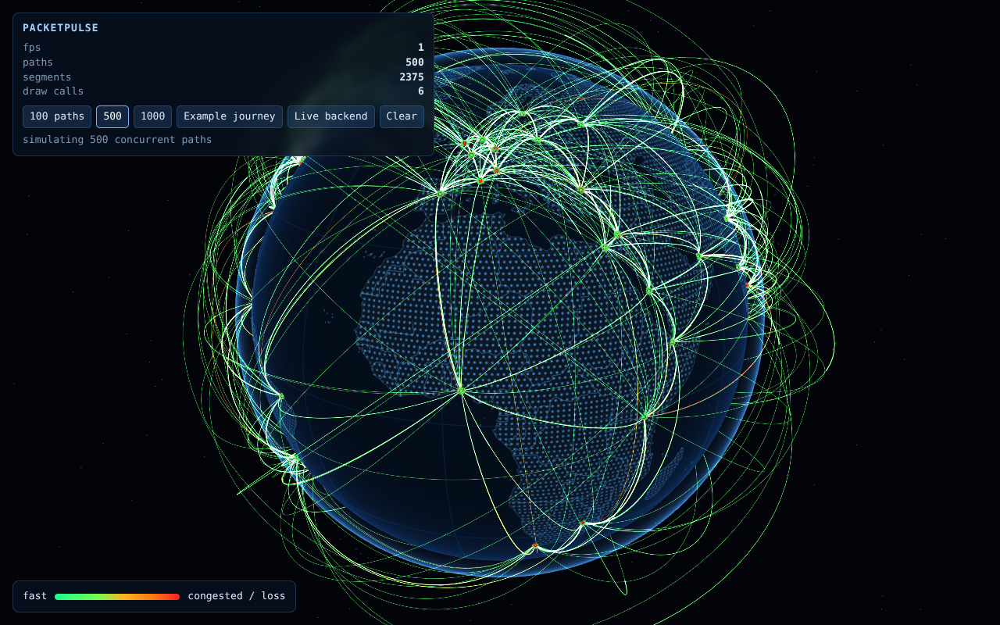
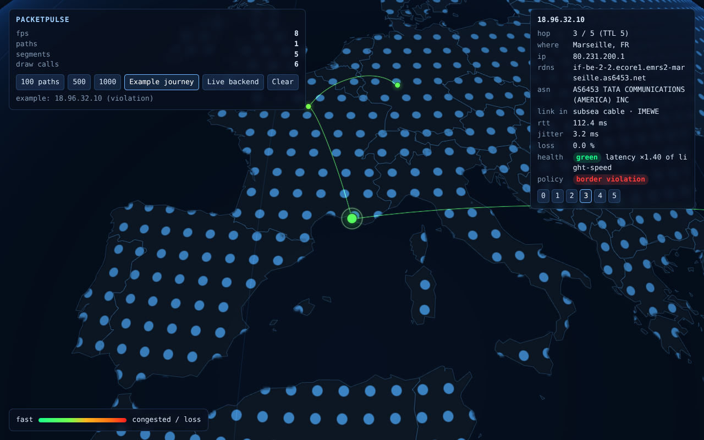
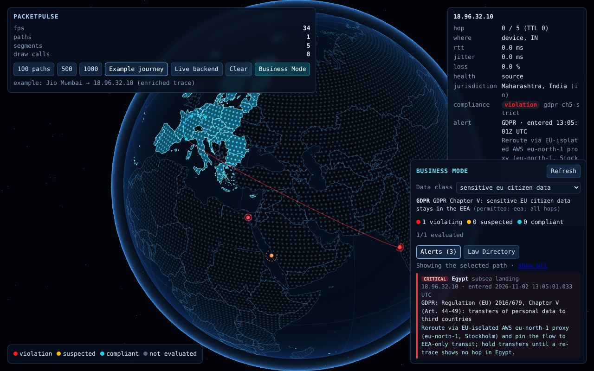
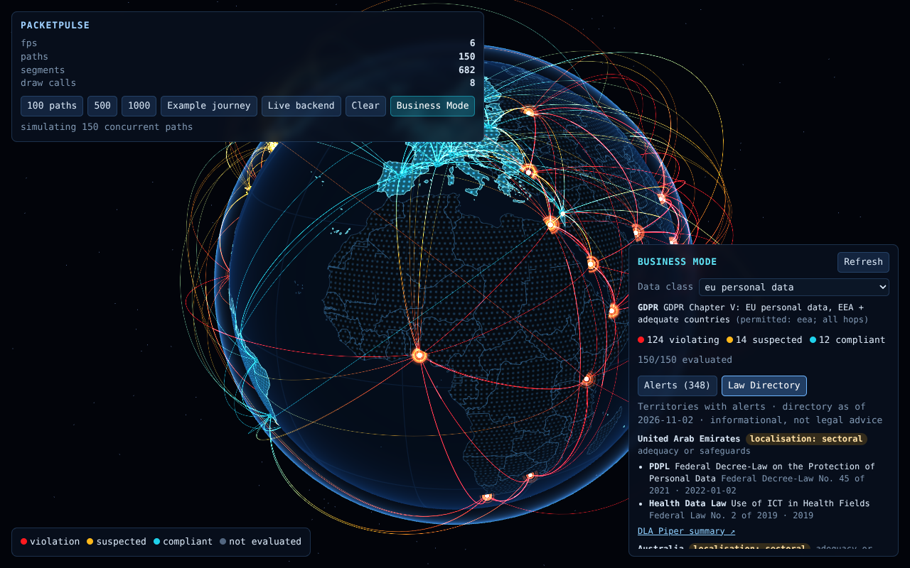
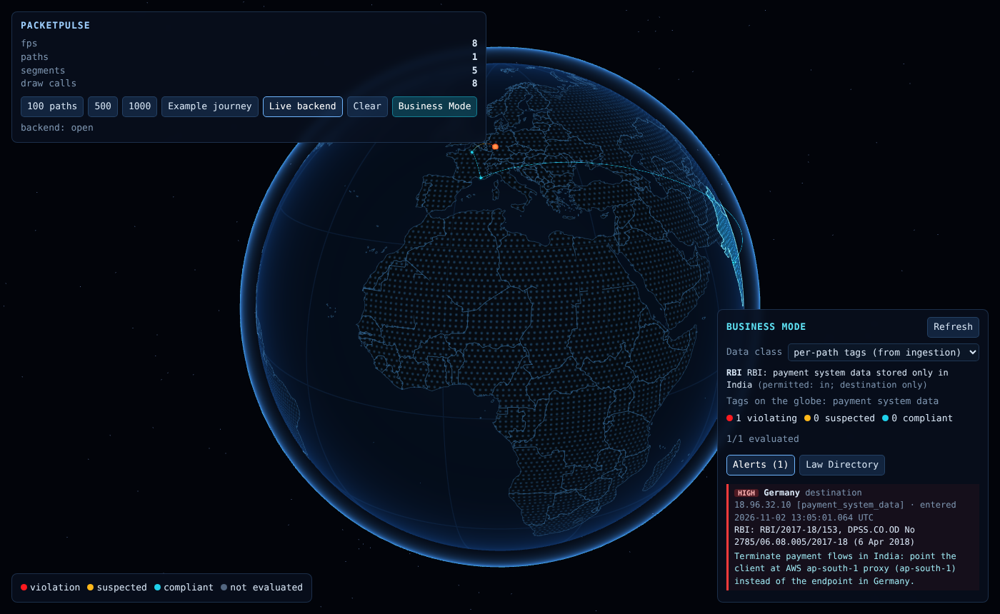

# PacketPulse globe (Three.js)

An embeddable WebGL globe that draws packet paths as animated, latency-coloured arcs. Any number of paths renders in **one draw call for all arcs and one for all hop markers** (6 draw calls for the whole scene).




```bash
npm install
```

```bash
npm run dev
```

Then open `http://localhost:5173/`. With no query the globe follows the backend live (`/v1/stream`; run `go run ./cmd/packetpulse -data-dir ../data -web none` in `backend/` first, and Vite proxies `/v1` to :8080). Other modes: `?demo=500` (simulated load) and `?example=1` (the backend's Mumbai → Frankfurt journey). The **Trace from my computer** panel queues traces on your `ppagent` (see the root README).

```bash
npm test
```

```bash
npm run build
```

## Business Mode (data sovereignty)




The **Business Mode** button checks every path on the globe with the compliance engine (`backend/cmd/complianced`) and recolours the scene:

- **Jurisdiction overlay:** permitted regions of the profiles that govern the chosen data class are tinted teal with border lines; deny-list regions are red; other land is dimmed. Borders come from the engine (`/regions/{id}/geometry`), so regions admins add or change at runtime are drawn as defined.
- **Routes:** arcs and hops switch from latency colours to compliance status: teal compliant, amber suspected (uncertain location or pending review, e.g. US recipients that need a DPF check), flashing red violation, grey when no profile governs the traffic. Every point inside a non-permitted territory is coloured, not only the entry point, and a subsea segment turns red when its cable lands in a non-permitted country between two compliant hops.
- **Alerts:** a pulsing marker at each territory entry (dashed when suspected), and a panel listing alerts with the law (e.g. GDPR Chapter V), entry time and recommended reroute. Click an alert to fly there. Selecting a hop filters the panel to its path, and the hop inspector shows its jurisdiction and verdict.
- **Law Directory tab:** the curated laws (`data/curated/regulations/jurisdictions.json`) for the territories the traffic touches.



**Data class.** The default, **per-path tags (from ingestion)**, evaluates each live path with the `data_classification` labels ingestion assigned to it (see `backend/README.md`). Untagged paths are not governed by any profile and stay grey; the overlay shows the jurisdictions of every profile that governs a tag on screen. Picking a class instead evaluates every path as if it carried that class (a what-if view, and the mode for simulated paths, which carry no tags). URL: `&class=tags` or `&class=eu_personal_data`; `?live=1&business=1` starts in tag mode.

The globe uses the engine's preview mode (`/v1/compliance/evaluate/batch` with `publish: false`): it never raises alerts into the operational stream. Only new or rerouted paths are re-evaluated; latency-only updates can't change compliance. **Refresh** picks up profile changes admins make through the API.

Run it locally:

```bash
cd backend && go run ./cmd/packetpulse -data-dir ../data -web none
```

```bash
cd frontend && npm run dev
```

Or everything on one port: `docker build -t packetpulse . && docker run -p 8080:8080 packetpulse` from the repo root, then `http://localhost:8080/?live=1&business=1`.

Then open `http://localhost:5173/?example=1&business=1` (or `?demo=300&business=1&class=eu_personal_data`). Vite proxies `/v1` (including `/v1/compliance`) to :8080; set `PACKETPULSE_COMPLIANCE=http://localhost:8090` to use a standalone `complianced`. In production, serve the globe from the same origin (the Docker image does) or proxy `/v1` to the API (the Vercel deployment does).

## Component API

```ts
import { PacketGlobe } from "./src/PacketGlobe";

const globe = new PacketGlobe({ container: document.getElementById("globe")! });
globe.setPath({
  id: "trace-42",
  hops: [
    { lat: 19.07, lon: 72.88, rttMs: 0 },
    { lat: 43.30, lon: 5.37, rttMs: 112.4, jitterMs: 3.2, lossPct: 0, medium: "subsea_cable", cable: "IMEWE" },
    { lat: 50.11, lon: 8.68, rttMs: 128.6 },
  ],
});
globe.onSelect((sel) => console.log(sel?.hop));   // fired when a hop is clicked
await globe.focusHop("trace-42", 1);               // fly the camera to a hop
await globe.focusPath("trace-42");                 // frame a whole path
globe.setPath({ ...sameIdNewLatencies });          // same geometry -> colours glide to the new state
globe.removePath("trace-42");
```

`journeyToPath()` (`src/data/journeyAdapter.ts`) converts backend PacketJourney documents; `connectBackend()` wires the live stream.

## How it works

| File | What it does |
|---|---|
| `src/render/ArcLayer.ts` + `arcShader.ts` | **Instanced arcs.** Every hop-to-hop segment is an instance of one 48-step ribbon strip. All per-segment data (4 Bézier control points, colour state, timing, style: 26 floats) lives in one interleaved `InstancedInterleavedBuffer`. The vertex shader evaluates the cubic Bézier and extrudes the strip in screen space (constant pixel width). Slots are recycled through a free list, and only the dirty slot range is uploaded (`addUpdateRange`). Updating one path's latencies uploads about 600 bytes. |
| `src/core/curve.ts` | Arc shape. Control points sit above the great circle at ¼ and ¾. Their radius is solved so the midpoint peaks at a height that grows with distance (flat metro hops, high intercontinental arcs). The same maths runs on CPU and GPU. |
| `src/core/health.ts` | **Latency → colour.** Each hop gets a severity in [0, 1] from latency excess (ΔRTT ÷ speed-of-light RTT for the distance), jitter and loss, using the backend's green/amber thresholds. The gradient stops are emitted as GLSL, so markers and arcs match. Loss ≥ 2% flashes red. Colour changes glide from the colour currently on screen, so rapid updates never jump. |
| `src/render/arcShader.ts` (fragment) | Soft glow, a packet pulse that travels the whole path (stable phase per path), draw-in when a path appears, dotted cellular links and dashed links of unknown medium, and dimming of other paths while one is selected. |
| `src/render/HopLayer.ts` | All hop markers in one `THREE.Points` with ranged buffer uploads, plus a pulsing ring on the selected hop. |
| `src/camera/GlobeControls.ts` | Drag-rotate with inertia (speed scales with altitude), exponential wheel/pinch zoom on altitude, and `flyTo` (great-circle slerp with ease-in-out that pulls back on long flights). Near the ground the camera orbits south of the target for an oblique view while the target stays centred. Any input cancels a flight. |
| `src/PacketGlobe.ts` | Component: path diffing (same geometry → colour retarget only), screen-space hop picking (front hemisphere only), selection and focus, stats. |
| `src/render/Earth.ts` | Dot-matrix Earth rasterised at runtime from Natural Earth polygons (`public/data/land.json`, 300 KB, built by `scripts/build_land.py`), plus borders, atmosphere and stars. No tile server. |

## Measured (headless Chromium, software GPU)

| 1,000 paths / 4,809 segments | |
|---|---|
| Draw calls for the whole scene | 6 |
| Insert all 1,000 paths (JS) | 22 ms |
| Live latency update for 100 paths (JS) | 3.5 ms |
| GPU upload for one path update | 624 bytes |

Frame rate needs a real GPU (the CI sandbox rasterises on the CPU).
